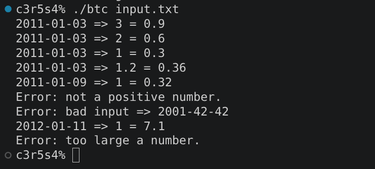
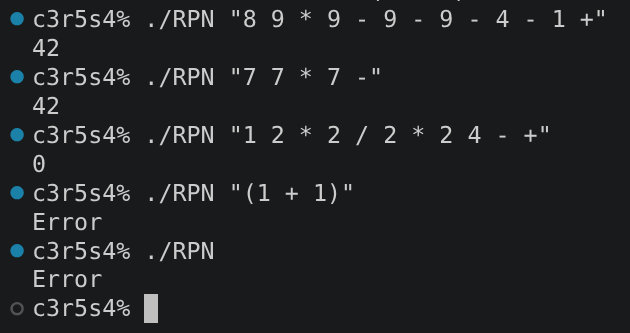
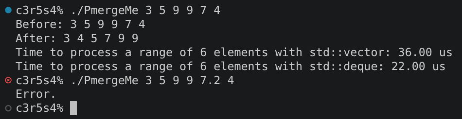

# cpp_module_09

### Clarifications and general tips:

* If you find any kind of error or have suggestions to improve, please do not hesitate to point them out in the `issues` section! Obviously always respectfully, thank you :D.
* Always remember that the output examples are just examples. They can vary in your own project and still be fine.
* If you have completed all the C++ projects except this one, be warned! This one takes longer to complete than the previous ones.
* The data.csv and input.txt files in ex00 must not be included in the official project evaluation. They are only provided in this repository for testing purposes.

## ex00: Bitcoin Exchange

### Mandatory requirements completed and how:

* Create a program named `btc` that:
    * Takes a file as an argument.
		- The program ensures that there are enough arguments to run and opens the input file itself to check its viability.
    * Reads a database in CSV format containing historical Bitcoin exchange rates.
		- Here, the program makes the same file check that is done with the input file. Then, the CSV database is stored in a `std::map<std::string, float>`, using each date as the key and its corresponding Bitcoin exchange rate as the value. 
		- Although, while I was working I stored the input file's contents in a container. As I developed the project, I realized that this was unnecessary: the program can process the input file line by line.
    * Processes an input file where each line follows the format `date | value`.
		- The program reads the input file byte by byte and accumulates its contents in a string until it encounters a line break.
		- In the subject, there aren't any rules about how the file structure is supposed to be, it just gives you an input example that starts with a header and ends in an empty line. That's why this program uses a structure that reads, checks, stores and prints the result for each line, even if it is an error message.
		In this way, when the first line is complete, the program checks whether it matches the expected header. If it does not, an error is reported, but processing continues (this is very important to validate the project).
		- One issue with this approach is that a file without an empty line at the end is technically correct, so without additional handling, that line that doesn't end with a line break would not be processed by the main loop. To solve this, I extracted the line-processing logic into a separate function, `process_line`, which is also called after the loop to process any remaining content (if exists).
    	* Validates dates in the `Year-Month-Day` format.
			- The `date_parser` function validates the date format (YYYY-MM-DD) by checking the number of hyphens (this checks the structure and also searches for negative numbers, giving an error if there aren't exactly two), and ensuring that the year, month and day contain only the necessary digits.
			- Once we can ensure that all the date parts are numbers, the program checks if there are possible dates (between 1 and 31 in case of the days, and 1 and 12 in case of the months). Here I needed to have exceptional care with the special days such as leap years or months that do not end on the 31st. To solve this situation, the program checks the leap years only if the month is February, and the `check_date` function checks whether the day (if it is the 30th or 31st) is valid according to the month. It uses the month number's parity (even or odd) and whether the month is before or after July to determine which days should be rejected. At the end it returns 1 when the day fails these checks and 0 otherwise.
    	* Accepts positive integer or floating-point values between `0` and `1000`.
			- Since the requirements for the value number are these few, `value_parser` only ensures that it is a valid integer or floating-point number within the permitted range of 0 to 1000. The `isInt` and `isEsInt` functions check whether the value's characters conform to the expected numeric format.
    * Calculates the value of the given amount by multiplying it by the corresponding Bitcoin exchange rate.
		-  The calculation is done in the same function that prints the solution (`solution_printer`), right before showing it in the output and with the correct format, all the necessary values are recovered and used to form the result. The function searches for the specific date in the container that saves a copy of the CSV file. If it finds it, it does the calculation with the value in the map container that has the same key as the date.
    * Uses the closest lower date from the database when the exact date is not available.
		- If inside `solution_printer`, the date isn't found, the function uses `lower_bound` to find in the map container the first key that is greater than or equal to date. But that's not good enough for us, the subject said we need the "closest lower date", so that's why when `lower_bound` finds the date, it selects the preceding key, which represents the closest available earlier date. If that key is the first one in the list or there isn't any previous date, the program displays an error. If it is the last one it goes back on the preceding key, choosing the previous date, and since the `databaseS` is sorted by key, we will obtain the closest lower date.
	* Use at least one STL container to store and process the data.
		- This project uses `std::map` as its main associative container. Each key represents a date, and each mapped value stores the corresponding Bitcoin exchange rate. Since the keys are ordered, the container is suitable for looking up exchange rates and finding the closest earlier date.
	* Handle possible errors with appropriate error messages, including invalid dates, negative values, values exceeding the allowed limit and malformed input.
		- The errors are handled with exception classes, with the corresponding error messages defined in the .cpp files.

### What can we learn about this exercise?

This exercise introduces **file parsing, data validation and associative containers** through a program that processes historical Bitcoin exchange rates. It also teaches us how to search for the closest available earlier date in an ordered database and handle invalid input safely.

### Output example:

## ex01: Reverse Polish Notation

### Mandatory requirements completed and how:

* Create a program named `RPN` that:
    * Takes a mathematical expression in Reverse Polish Notation (RPN) as an argument.
		- The program checks if there are only the necessary number of arguments in the input, if not an error message is displayed and the program ends.
	* Handles invalid expressions by displaying an error message on the standard error if a problem occurs during execution.
		- When the program has enough numbers to work, `line_parser` checks the basic structure of the expression. Searching for characters that aren't integers, spaces or the required mathematical expressions. It also validates the placement of spaces: leading and trailing spaces are not allowed, and each token must be separated by a space (except the final token). The function checks the following characters when necessary and handles boundary conditions to avoid accessing data outside the string.
    * Evaluates the expression and displays the correct result on the standard output.
		- The other function that checks the expression before any mathematical calculation is done is `expression_parser`, this function in particular counts the numbers and the symbols of the expression, ensuring that every operator has two operands available when it is evaluated. This helps detect malformed RPN expressions before performing the calculations.
		- Once the expression has passed validation, the program processes its tokens from left to right. The program first ensures that the first two operands are numbers (if not it displays an error). When it encounters an operand, it pushes it onto the stack. When it encounters an operator, it retrieves the two topmost operands and passes them to `stack_resolver`, which performs the corresponding calculation. The result is then pushed back onto the stack and can be used as an operand in a subsequent operation. After all tokens have been processed, the final result is displayed.
    * Supports the following operators: `+`, `-`, `/` and `*`.
		- Delving into `stack_resolver`, the function retrieves the two topmost operands from the stack before removing them. It converts them to integers and depending on the operator that is passed from `expression_processor`, it performs the operation. The result is stored in the structure `final_result`, and printed when the loop in `expression_processor` is over.
* Use at least one STL container to evaluate the expression.
	- The program uses `std::stack` to store operands and intermediate results. Its LIFO (Last In, First Out) behavior makes it suitable for solving the Reverse Polish Notation in the `stack_resolver` function, as the most recently pushed operands are the first ones retrieved when an operator is encountered.

### What can we learn about this exercise?

This exercise introduces **Reverse Polish Notation (RPN)**, a mathematical notation in which operators follow their operands. It teaches us how to evaluate expressions using an STL container, process tokens and perform arithmetic operations in the correct order without relying on parentheses or conventional operator precedence rules (mainly because they aren't allowed in the exercise).

### Output example:

## ex02: PmergeMe

### Mandatory requirements completed:

* Create a program named `PmergeMe` that:
    * Takes a sequence of positive integers as arguments.
		- This program needs at least two arguments to work, so first it checks the number of the arguments to make sure that there is more than one.
		- To check that the numbers are valid, `ArgumentParsing` checks each one making sure that they aren't below zero or higher than the maximum supported integer value.
    * Uses at least two different STL containers to validate this exercise.
      	- This exercise uses two different STL containers: `std::vector` and `std::deque`. Both are used to store and process the sequence, and their similar methods and functionality allow the same sorting algorithm to be implemented with two different container types. The program also uses `std::pair` that can group related values, it is useful for making the pairs.
    * Sorts the sequence using the **merge-insertion sort algorithm**, also known as the **Ford-Johnson algorithm**.
		- The **Ford-Johnson algorithm** is a sorting algorithm designed to minimize the number of comparisons required to sort a sequence, unlike functions such as `sort`, where this is not a priority. This is achieved, in part, because the algorithm leverages information from previous comparisons to avoid unnecessary ones.
		- To achieve the efficiency of the **Ford-Johnson algorithm**, the program should pair the elements, recursively sorting the larger elements and inserting the remaining elements into the sorted sequence using a carefully chosen order of binary insertions. Each one of their tasks is defined and implemented in this way:
			- Making pairs:
  				- A container of type `std::vector` or `std::deque` is created to store `PairNumbers` objects. Each object contains the larger value, the smaller value and a unique identifier for the pair.
				- Then the `main_creator` function is called (a template that supports both container types), and if the input sequence contains an odd number of elements, the unpaired element is stored separately. The remaining values are converted to integers, compressed in pairs and stored in `PairNumbers` objects, with the larger value recorded separately from the smaller one, and the two identified by a unique id.
			- Sorting the bigger ones: 
				- For each pair made, the elements recently classified as big numbers are added to a separate container. Before making any comparisons, the `main_creator` function is then called recursively to sort these big numbers with the **Ford-Johnson algorithm**, only if there are enough big numbers to sort.
			- Creating the "main chain": 
				- Once we have our big numbers ordered, `chair_function` reorders the pairs according to the sorted order of the big numbers container. All the ids in the main container will change and have the same order specified by the big numbers (controlling repeated numbers with a used flag).
				- With this new order, the program creates two groups containing the bigger and smaller elements, respectively. These groups store each value together with its unique pair id in `std::pair` objects. This makes it possible to retrieve the corresponding pair later, even though the elements are stored in separate containers.
				- Now that everything is in its place, we start creating the "main chain". It is initialized with the sorted bigger elements. The algorithm then inserts the smaller element belonging to the first pair at the beginning of the chain. Since that element is smaller than its corresponding bigger element, and the bigger elements are sorted, it is also smaller than the remaining elements in the main chain. This also reduces the number of comparisons.
			- Binary insertion: 
				- Finally, it is time to insert our smaller numbers in the `main_chain`. But first, to reduce the number of comparisons, `jacky_resolution` determines the insertion order for the smaller elements using the Jacobsthal sequence generated by `jacky_secuency`. In practice, we insert the pending elements in "groups" based on their position in the sequence, processing each group backwards between consecutive Jacobsthal numbers. For example, if the Jacobsthal sequence generated is 1 2 3 5 we insert backwards the elements at index 5 - 3, at index 3 - 2, then index 2 - 1, and then index 1. The number of elements generated in the sequence is equal to the size of `SmallOnes`.
				- Once the insertion order has been established, the smaller elements are inserted into `main_chain` using binary search. That means that before inserting the number, the function searches for the middle number of the chain, when it finds it, it checks if the number is higher or lower than the number in the middle, depending on the result it iterates until it finds the correct position of the number. However, in the **Ford-Johnson algorithm** we want the least number of comparisons, and to achieve this, in `binary_insertion` the search is restricted to the portion of the chain preceding the bigger element associated with the element being inserted, in this way, the pair identifier is used to locate that bigger element and determine the search boundary. This restriction exploits the relationship between the two elements of each pair and helps reduce the number of comparisons required.
    * Displays an error message on the standard error if an error occurs during execution.
		- The error message is displayed when the inserted arguments fail in `ArgumentParsing`, detecting wrong inputs.
	* Displays the unsorted sequence, the sorted sequence, the execution time for the first and the second container on the last line. Measure the time required for the complete operation, including sorting and data management.
		- The execution time is measured using `std::clock()`. For each container, the function registers the time when `main_chain` is called (in `startV`) and when it is done with the sorting (in `endV`). Finally, the difference between the two variables is converted to microseconds by multiplying it by one million and dividing by CLOCKS_PER_SEC. This provides an estimate of the CPU time consumed by the measured operation for each container. The reported time depends on the code included between the start and end measurements.

### What can we learn about this exercise?

This exercise introduces **advanced sorting algorithms, container comparison and performance measurement**. It focuses on the Ford-Johnson algorithm, which uses a merge-insertion strategy designed to reduce the number of comparisons required to sort a sequence. It also helps us understand how different STL containers can affect execution time when implementing the same algorithm.

### Output example:

#### Last but not least, check out these other repositories if you feel lost, they helped me a lot through the project:

https://github.com/leske42/CPP09
https://github.com/0x416c6941/cpp09/tree/main/cpp09/ex00
https://github.com/tigran-sargsyan-w/cpp-module-09#ex02--pmergeme